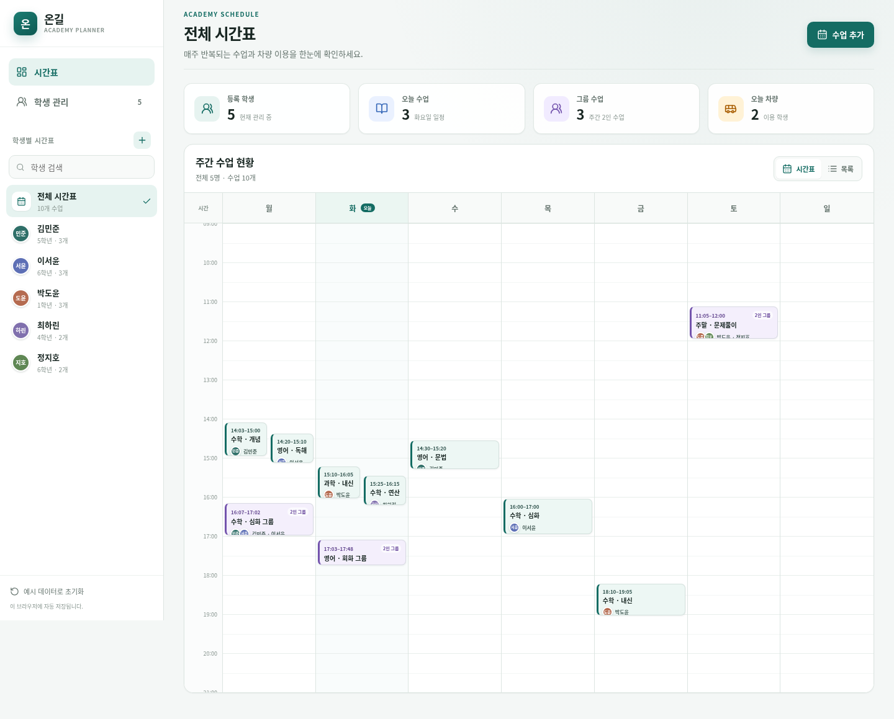

# 학원 시간표

학생별 주간 수업과 등·하원 차량 이용을 한 화면에서 관리하는 React/TypeScript 웹앱입니다.

배포 주소: <https://despite0506-rgb.github.io/ideal-tribble/>



## 주요 기능

- 학생별 주간 시간표 필터
- 수업별 직접 색상 설정과 초등 분홍·중등 하늘·고등 노랑 자동 색상(국어는 같은 계열의 고채도 색상)
- 서로 다른 학생의 동시간대 수업을 나란히 표시
- 10분 단위 시작·종료 시간과 30분 단위 시간축
- 두 명 이상 인원 제한 없이 구성하는 그룹 수업
- 학생별 상세 페이지, 피드백 기록 및 Notion 페이지 연결
- 학원 이름과 시간표 표시 범위 설정
- 수업 참가자별 등원·하원 차량 설정
- 학생과 수업 등록·수정·삭제
- 학생명·수업명 재입력을 통한 실수 방지 삭제 확인
- 시간표 수업을 눌러 바로 여는 날짜별 출석 체크
- 전체 원생 월별 출석 리포트, 선생님 필터 및 CSV 다운로드
- 모바일 일간 목록과 데스크톱 주간 타임라인
- 선생님 3명의 독립 시간표와 공유 학생 목록
- 학원 공용 비밀번호 로그인
- Supabase 클라우드 자동 저장, 실시간 수신 및 브라우저 로컬 백업
- 동시 수정 충돌 감지와 학생·수업 단위 병합

처음 로그인했을 때 클라우드가 비어 있으면 현재 브라우저의 기존 자료를 업로드하거나 빈 시간표로 시작할 수 있습니다. 최초 업로드 이후에는 같은 공용 비밀번호로 로그인한 기기들이 동일한 자료를 사용합니다.

## 클라우드 설정

Supabase 프로젝트에 `supabase/schema.sql`을 실행하고 Authentication에 `time@mange.local` 사용자를 생성합니다. 브라우저에는 공개용 publishable key만 포함하며, 데이터베이스 비밀번호와 `service_role` 키는 사용하지 않습니다. 테이블은 RLS 정책으로 공용 인증 사용자의 행만 읽고 수정할 수 있습니다.

## 실행

```bash
pnpm install --frozen-lockfile
pnpm dev
```

기본 개발 서버 포트는 `3000`입니다.

## 검증

```bash
pnpm typecheck
pnpm test
pnpm build
```

시간 변환, 동일 학생 충돌 방지, 동시간대 다수 학생 허용, 그룹 수업 무결성, 차량 상태, 출석 집계, 겹침 레이아웃 및 저장 데이터 검증을 테스트합니다.
